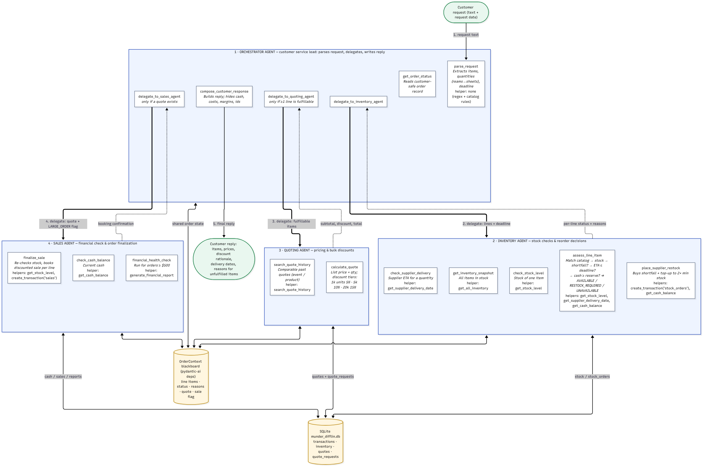

# Beaver's Choice Paper Company: Multi-Agent Quoting & Inventory System

**Deliverables in this repository**

| File | Content |
|---|---|
| `workflow_diagram.png` (source: `workflow_diagram.mmd`) | Agent workflow diagram |
| `project_starter.py` | Complete implementation (single Python file) |
| `test_results.csv` | Evaluation output for all 20 requests in `quote_requests_sample.csv` |
| `REPORT.md` | This document |

---

## 1. Summary

I built a **4-agent system with `pydantic-ai`**. An **Orchestrator** handles each customer request and delegates to three specialised workers: **Inventory**, **Quoting** and **Sales**. Every helper function from the starter code is wrapped in at least one agent tool. All 20 sample requests were processed:

* **18 of 20 requests produced a confirmed sale** (6 fully, 12 partly), and **each of these 18 changed the cash balance**.
* **2 requests were fully rejected**, and **12 partial orders listed the lines we could not supply**. Each case gives the customer a clear reason: the item is not in the catalog (A3/A5 sizes, balloons, tickets, cardboard), or stock is short and the supplier could not deliver before the customer's deadline.
* Cash grew from **$45,059.70 to $47,785.48**. The sales were profitable and the company never dropped below its cash reserve.

---

## 2. Architecture and the workflow diagram



### 2.1 Agents (4 of the allowed 5)

| # | Agent | Responsibility (no overlap) | Tools → starter helper functions |
|---|---|---|---|
| 1 | **Orchestrator Agent** | Customer-facing lead. Parses the request, decides which workers to call and in what order, and writes the final customer reply. It never reads or writes the database directly. | `parse_request` (regex + catalog rules), `delegate_to_inventory_agent`, `delegate_to_quoting_agent`, `delegate_to_sales_agent`, `get_order_status`, `compose_customer_response` |
| 2 | **Inventory Agent** | Matches requested items to the catalog, checks stock, decides whether and how much to reorder, and places supplier orders. | `get_inventory_snapshot` → **get_all_inventory**; `check_stock_level` → **get_stock_level**; `check_supplier_delivery` → **get_supplier_delivery_date**; `assess_line_item` → get_stock_level + get_supplier_delivery_date + **get_cash_balance**; `place_supplier_restock` → **create_transaction**('stock_orders') + get_cash_balance |
| 3 | **Quoting Agent** | Prices the lines that can be fulfilled, applies the bulk-discount policy and looks up comparable historical quotes. | `search_quote_history` → **search_quote_history**; `calculate_quote` (list price × qty, discount tiers) |
| 4 | **Sales Agent** | Checks finances, runs a full financial health check before large orders, and books the sale. | `check_cash_balance` → **get_cash_balance**; `financial_health_check` → **generate_financial_report**; `finalize_sale` → get_stock_level + **create_transaction**('sales') |

All 7 required helpers (`create_transaction`, `get_all_inventory`, `get_stock_level`, `get_supplier_delivery_date`, `get_cash_balance`, `generate_financial_report`, `search_quote_history`) are used inside tools. `get_all_inventory`, `get_cash_balance` and `generate_financial_report` are assigned to agents as the brief requires: Inventory, Inventory/Sales and Sales respectively.

### 2.2 Orchestration flow (numbers match the diagram)

1. **Request in.** The orchestrator calls `parse_request`. This extracts each line (quantity + description; reams are converted to sheets at 500 per ream), the customer's deadline ("by April 15, 2025") and the request date.
2. **Inventory.** The orchestrator delegates to the Inventory Agent, which takes an inventory snapshot and then assesses every line:
   * The line is matched to the catalog. Unsupported formats (A3/A5) and non-catalog products (balloons, tickets…) become **UNAVAILABLE**.
   * If there is enough stock, the line is **AVAILABLE**. If the sale would push a carried item below `min_stock_level`, a replenishment order is placed to bring stock back to 2× the minimum. This is the reorder decision.
   * If stock is short, the agent asks the supplier for the delivery date of the required quantity. If that date is after the customer deadline, the line becomes **UNAVAILABLE** with the reason. If paying for the restock would push cash below the $2,000 reserve, the line also becomes **UNAVAILABLE**. Otherwise the line is **RESTOCK_REQUIRED** and the agent places the supplier order.
3. **Quote.** This step runs only if at least one line can be fulfilled. The Quoting Agent searches quote history for comparable orders, then prices the lines:
   * 1,000+ units: **5%** off
   * 5,000+ units: **10%** off
   * 20,000+ units: **15%** off
4. **Sale.** The Sales Agent checks cash. For orders of $500 or more it runs `generate_financial_report` as a health check. It then re-checks stock and records one `sales` transaction per line at the discounted price.
5. **Reply.** The orchestrator composes the customer reply. It lists the items, unit prices and totals, explains any discount, gives the expected delivery date, and states the reason for every line we cannot supply, with a partial-quantity offer where that helps.

### 2.3 Key design decisions

* **Why 4 agents and not 5?** Inventory, Quoting and Sales are the three business functions in the brief, and each maps to one worker with its own tools. A fifth agent (for example a separate "request parser" or "reporting" agent) would add another hand-off without a separate business responsibility.
* **Shared blackboard (`OrderContext` as pydantic-ai `deps`).** Agents pass *decisions* to each other, not large JSON payloads that an LLM would have to copy. The line items, statuses, quote and sale flag sit in one typed dataclass that every agent's tools read and write. This removes a whole class of errors where an LLM mis-copies a quantity or price between agents.
* **The LLM decides the flow; the tools hold the business rules.** The agents decide which tools to call, in which order, and whether to call a worker at all (for example, no quote and no sale when nothing can be fulfilled). Prices, discounts, reorder quantities and database writes are deterministic Python code. Money values are therefore auditable and cannot be made up by a model.
* **Pricing and margin.** The starter seeds stock at list price. Restocking at list price would make every restocked sale break even and every discount a loss. I therefore set a supplier wholesale cost of 70% of list price (`SUPPLIER_COST_RATIO`). With the largest discount capped at 15%, no sale is below cost. Customer quotes follow the historical quotes, which charge list prices with friendly volume discounts.
* **Timeline logic.** All transactions are dated on the request date, so the evaluation loop's `generate_financial_report(request_date)` sees them. In-stock lines ship right away. Restocked lines are promised for the supplier's delivery date, and only if that date falls on or before the customer's deadline.
* **Two run modes, same agents.**
  * **LLM mode** (when `UDACITY_OPENAI_API_KEY` is set) uses `gpt-4o-mini` through the Vocareum proxy.
  * **Offline mode** (no key, or `BEAVER_OFFLINE=1`) backs each agent with a pydantic-ai `FunctionModel` running a scripted policy that issues the same tool calls. Offline mode is how the system was tested here, because the build environment had no API key or network access to the proxy.

### 2.4 Starter-code adjustments (documented)
* `run_test_scenarios()` called `init_database()` without the required engine argument. It is now `init_database(db_engine)`.
* `quote_requests.csv`, which `init_database` needs, was **not included in the repository**. If the file is missing, `init_database` now builds a stand-in table from the metadata in `quotes.csv`, so `search_quote_history` still works. If the original file is added, it is used automatically.

---

## 3. Evaluation results (`test_results.csv`)

Generated with `BEAVER_OFFLINE=1 python project_starter.py`. Starting cash was $45,059.70 and starting inventory value was $4,940.30.

| Req | Date | Outcome | Δ cash | Reason for unfulfilled lines |
|---|---|---|---|---|
| 1 | 04-01 | Full | +65.00 | – |
| 2 | 04-03 | Partial | +42.00 | balloons not in catalog |
| 3 | 04-04 | Partial | +1,575.07 | A3 paper not in catalog (250,000 sheets of copy paper and 10,000 A4 restocked and sold at a 15% discount) |
| 4 | 04-05 | Full | +47.14 | – |
| 5 | 04-05 | Full | +68.75 | – (5% bulk discount) |
| 6 | 04-06 | Full | +19.25 | – (5% bulk discount) |
| 7 | 04-07 | Partial | +330.52 | A3 matte paper not in catalog |
| 8 | 04-07 | Partial | +130.00 | A5 paper not in catalog |
| 9 | 04-07 | Partial | +3.75 | A3 glossy not in catalog |
| 13 | 04-08 | Partial | +9.00 | A4: 270 on hand, supplier ETA Apr 12 > deadline Apr 10 |
| 12 | 04-08 | Full | +15.60 | – |
| 10 | 04-08 | Full | +43.50 | – |
| 11 | 04-08 | Partial | +16.20 | A3 glossy not in catalog |
| 14 | 04-09 | Partial | +22.50 | A4 (5,000) and poster paper: supplier ETA Apr 16 > Apr 15 |
| **15** | 04-12 | **Rejected** | 0.00 | A4 ETA Apr 19 > Apr 15; A3 and cardboard not in catalog |
| 16 | 04-13 | Partial | +100.00 | A4 and construction paper cannot arrive by Apr 15 |
| 17 | 04-14 | Partial | +50.00 | A4, napkins, cups: supplier ETA after Apr 15; A3 not in catalog |
| **18** | 04-14 | **Rejected** | 0.00 | cardstock, copy paper and colored paper cannot arrive by Apr 15 (one day away) |
| 19 | 04-15 | Partial | +37.50 | 2,000 glossy: ETA Apr 22 > Apr 20; A3 not in catalog |
| 20 | 04-17 | Partial | +150.00 | posters and tickets are printing services, not catalog items (5,000 flyers sold at 10% off) |

Final position: **cash $47,785.48** (up $2,725.78), **inventory value $4,326.75**.

**Rubric checks**
* ≥ 3 requests change the cash balance: **18 do.**
* ≥ 3 quote requests fulfilled: **18 have confirmed sales, 6 of them in full.**
* Not all requests fulfilled, with reasons given: **2 fully rejected and 12 partly unfulfilled, each with an explicit reason.**

### 3.1 Strengths
1. **Correct handling of impossible constraints.** The system separates "we don't sell this" (catalog miss) from "we sell it, but the supplier cannot deliver before your date" (timeline miss). Both are explained to the customer with concrete numbers (units on hand, supplier date, deadline). Where useful, it offers the quantity that is available now.
2. **Proactive stock management.** Supplier orders cover each shortfall, and carried items are refilled to 2× their minimum level after a sale. Every purchase is checked against a cash reserve. Request 3 shows the full chain: a 10,000 + 250,000-sheet order was restocked, delivered within the 7-day lead time and sold at a profit.
3. **Transparent, safe customer messages.** Each reply shows the unit price, line totals, subtotal and the discount rule applied ("10% bulk discount for orders of 5,000+ units"). Internal data (cash balance, supplier cost, margin, transaction ids, error traces) never reaches the customer. Exceptions are caught and replaced with a polite fallback message.
4. **Profitable and consistent pricing.** Discounts reward volume (5%, 10%, 15%), stay below the 30% gross margin, and match the "bulk discount on list price" pattern in `quotes.csv`.

### 3.2 Weaknesses observed
* **A4 paper becomes a recurring bottleneck.** Its replenishment target (2 × 135 = 270 sheets) is far smaller than the typical order (500–10,000 sheets). From April 8 onward, many A4 lines miss their deadline.
* **Strict size matching.** The rules treat "A3 glossy paper" as unavailable rather than offering Glossy paper as a substitute.
* **All-or-nothing lines.** A line is either delivered in full or refused. Partial shipments are only offered in the text, not booked.

---

## 4. Suggestions for further improvement

1. **Demand-driven reorder points.** Replace the static `min_stock_level` with a reorder point computed from recent sales: average daily demand × supplier lead time + safety stock. This would raise the A4 target automatically after the first large A4 orders, so later A4 requests (13–17) could be filled from stock instead of being refused. It also suits the tiered lead times in `get_supplier_delivery_date`: one larger order (7 days) is better than repeated rush orders.
2. **Substitutions and split shipments.** Let the Inventory Agent suggest the closest catalog item (for example "Glossy paper (A4/letter size)" for "A3 glossy"), and let the Sales Agent book split shipments: the in-stock quantity now, the rest on the supplier date. With customer confirmation, this turns many partial or rejected orders into sales.
3. **Customer-aware pricing using quote history.** `quotes.csv` records `job_type`, `order_size` and `event_type`. A small regression of historical `total_amount` on those features could support segment-specific discounts (for example for schools or non-profits) and check that each new quote is competitive.
4. **Use the fifth agent slot for an LLM request parser.** The regex parser handles all 20 samples, but free-form messages ("a couple of boxes of …") would benefit from a dedicated extraction agent with a typed `List[LineItem]` output. This would also let the system answer pure stock questions ("do you have kraft paper?") instead of asking the customer for quantities.

---

## 5. How to run

```bash
pip install -r requirements.txt
# LLM mode: put UDACITY_OPENAI_API_KEY=... in .env
python project_starter.py
# Offline/deterministic mode (no API key needed):
BEAVER_OFFLINE=1 python project_starter.py
```
Output: `test_results.csv` plus a printed financial summary per request.
